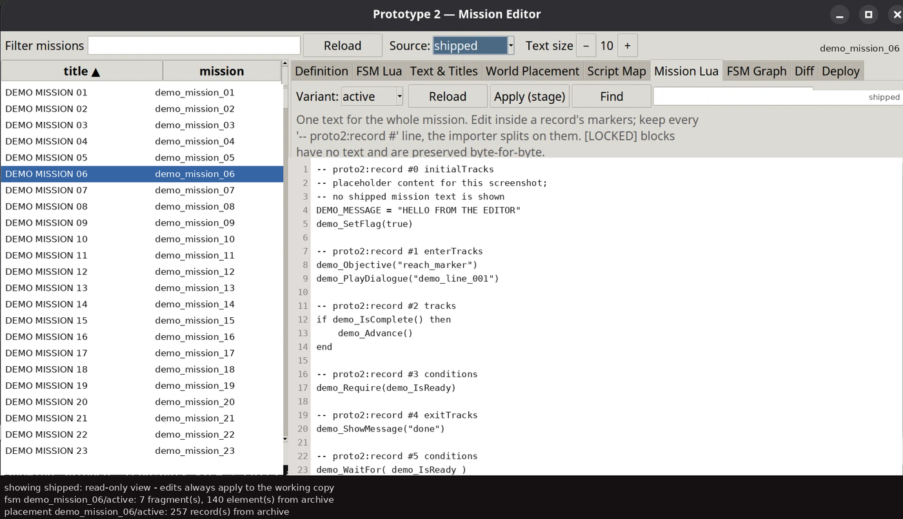

# Prototype 2 — mission editor and modding toolkit

> **Work in progress, preliminary stage.** Every record is editable and each edit is verified against the
> shipped bytes before it is written - the mission Lua is effectively 100% editable - but the tooling is
> still under active development: interfaces and file layouts change, and creating a *new* mission name
> is not supported yet (authoring inside an existing mission works). Treat the commands and formats here as
> current, not stable.



*The editor with placeholder mission content (no shipped mission text is shown).*

**This is primarily a mission editor for Prototype 2** (Radical Entertainment, 2012): a desktop GUI and a CLI that
open a mission, list every record, edit its Lua, FSM graph, text and placement, verify each edit against the shipped
bytes, and install the result as loose files - without patching the game.

The format documentation (`docs/`) is **not shipped** in this repository - it is kept with the working copy and the
references below name those local files. Behind the tooling sits the reverse engineering that made it possible: the `ATG CORE CEMENT LIBRARY` archives, the Pure3D
asset format, the Lua 5.1 scripting layer, the mission definition schema and the engine DLL that ties them together.
All of it was derived from retail builds.

## Thanks

The Lua in this game could not be recovered without other people's compilers and decompilers. None of them is
vendored here: each is built from its own source at a pinned revision, by the script in the last column.

| project | licence | built by |
|---|---|---|
| [Lua 5.1.5](https://www.lua.org/) | MIT | `tools/build_luadec.sh` |
| [LuaDec](https://github.com/viruscamp/luadec) (viruscamp) | MIT-style, same as Lua | `tools/build_luadec.sh` |
| [unluac](https://sourceforge.net/projects/unluac/) (tehtmi), built from [HansWessels' fork](https://github.com/HansWessels/unluac) | MIT | `tools/build_unluac.sh` |
| [unluac-rs](https://github.com/x3zvawq/unluac-rs) (x3zvawq) | MIT | `tools/build_unluac_rs.sh` |

Thanks also to [emoose](https://github.com/emoose) for PrototypeFix and
[ThirteenAG](https://github.com/ThirteenAG) for Ultimate-ASI-Loader: without loose-file preference and the ASI
loader, none of these edits would reach the game.

## What you can do today

- **Desktop editor** - `./proto2 gui` is the main surface: mission list on the left, tabs for definition, FSM graph,
  scripts, text, placement, diff and deploy. Edits are staged and reach the game through one **Install** button.
- **Mission scripts** - each mission is a Pure3D package holding dozens of *records* (Lua scripts, FSM tracks,
  conditions). 4,750 of the 4,793 records convert to editable source from the shipped files alone; arbitrary edits
  run: an inserted `snd_Trigger(...)` at the top of `story_intro1`'s retry handler was heard in game on 2026-10-27
  (docs/25).
- **Override pack** - `./proto2 overrides apply` brings the 43 hand-reconstructed records that no decompiler can
  regenerate, and it ships here (docs/26). Your own install supplies the rest:
  `./proto2 corpus && ./proto2 convert-all` covers 951 records, and the pack adds the last 43. Without it those 43
  stay bytecode and show up read-only.
- **FSM graphs** - inspect states and transitions, replace script text, and re-emit the chunk byte-identically.
- **Titles and text** - edit the English text bible, including mission names and descriptions of any length.
- **Definition and placement** - edit mission constants, aspects, time of day and placed objects.
- **Install and revert** - deploy staged edits as loose files through PrototypeFix, or undo them in one command.
  The game binaries are never patched.

Everything below the editor is documented as evidence: format write-ups, tooling and the recovery ledger.

## Install from a clean clone

### What you need

| requirement | why | how |
|---|---|---|
| **Linux** (x86-64) | the tooling is Python + Tk and has only been tested here; the game itself runs through Steam/Proton | — |
| **Python ≥ 3.8 with tkinter** | every tool is Python 3 standard library; only the GUI needs tkinter | `apt install python3 python3-tk` |
| **Your own Prototype 2 install** | no game files are shipped here; every byte is read from your copy | Steam → *Prototype 2* |
| **Ultimate-ASI-Loader** (`binkw32.dll`) + **PrototypeFix** (`prototype_fix.asi`, `prototype_fix.ini`) | the game only loads `.asi` plugins through the loader, and only prefers loose files when PrototypeFix sets `PreferLooseFiles = true`. Both are third-party and **not distributed here**; docs/12 explains what they do | install Ultimate-ASI-Loader as `binkw32.dll`, then PrototypeFix v1.6+ (by emoose) into the game directory; `prototype_fix.ini` must contain `PreferLooseFiles = true` |
| *Optional:* `i686-w64-mingw32-gcc` | rebuild the `.asi` probes (the recorder, the Lua bridge); their sources are not shipped | `apt install gcc-mingw-w64-i686` |
| *Optional:* a JDK (`javac`) | build **unluac**, the fallback that recovers 43 records LuaDec cannot | `apt install default-jdk` |
| *Optional:* a Rust toolchain (`cargo`) | build **unluac-rs**, the fallback that recovers 63 more | `curl https://sh.rustup.rs -sSf \| sh` |

### Steps

```bash
# 1. clone and enter the repository
git clone https://github.com/nl-saw/proto2edit
cd proto2edit

# 2. point the tooling at your game directory (validated: must contain prototype2engine.dll)
./proto2 config set game_dir "/path/to/Prototype 2"
#    the editor already works from here (./proto2 gui); the remaining steps add
#    bytecode decompiling, the extracted corpus and the in-game debug menu

# 3. check the machine; every line says what is missing and how to fix it
./proto2 doctor
#    expect:  doctor: ready (0 warning(s))

# 4. build the LuaDec/Lua kit: needed to decompile and convert bytecode records, and this
#    step needs network access once (it clones the upstream source). Skip it if you only
#    edit text.
bash tools/build_luadec.sh
#    expect:  build/luadec-p2/bin/{luadec,luac}

# 4b. optional, but needed for the last ~1.4% of records: two more decompilers, each built
#     from source at a pinned revision. Without them those records stay read-only.
bash tools/build_unluac.sh        # needs a JDK;  expect build/unluac/classes
bash tools/build_unluac_rs.sh     # needs cargo;  expect build/unluac-rs/unluac-cli

# 5. extract the mission corpus (430 files, a few seconds; tmp/ is scratch)
./proto2 corpus
#    expect:  corpus: wrote 430, skipped 0 (2 archive(s))

# 6. run the self-checks
./proto2 check
#    expect:  all checks passed         (12 checks)

# 7. install the debug menu (kept installed: the in-game debug page is the fastest way to check a change)
./proto2 install
#    expect:  N file(s) installed.
#    this step needs PrototypeFix from the table above, otherwise the game ignores it

# 8. open the editor and make your first change
./proto2 gui
#    pick a mission, edit a record, press Install; docs/10 has the per-workflow recipes
```

### First edit

```bash
# GUI (the normal way): pick the mission on the left, edit in the Script Map tab,
# then Deploy -> Install
./proto2 gui

# command-line equivalent: rename a mission, install, then launch the game
./proto2 set-title story_a1 "BRAIN DRAIN (EDITED)"
./proto2 install
./proto2 play            # prints how to launch and which log lines to check
```

Edits are staged first; nothing reaches the game until `install` (or the GUI's **Install** button). To undo every
staged edit and put the game back to the clean state (debug menu + override pack), run `./proto2 clean`.

### Verify that the game sees the files

```bash
./proto2 status        # lists every installed file; enable_debug.rcf must be there
./proto2 play          # prints the launch command and the log lines to check afterwards
grep -iE "fe_textbible|missiondefinit" "<game>/prototype_fix.log" | tail
```

If `prototype_fix.log` never mentions a file you installed, the game is not preferring loose files: check
`PreferLooseFiles = true` in `prototype_fix.ini` and that `binkw32.dll` is the ASI loader.

### Jump straight into a mission

The engine has a dev option that skips the menus: a line `Level=<mission>` in `args.txt` in the game directory boots
directly into that mission's start. The harness writes and cleans it for you, so one run is one command pair:

```bash
./proto2 launch --level story_a1 --begin   # writes args.txt, archives the previous logs
# ... start the game; it drops you at the mission start ...
./proto2 launch --end                      # collects the logs and removes args.txt again
```

`--level` validates the name against the game's own valid-mission list and warns when the name only has the
fallback config (which does not start). Without `--level`, `./proto2 launch --begin|--end` just wraps a normal run.

### Update, uninstall, reset

```bash
git pull && ./proto2 install   # refresh the payload after an update
./proto2 revert                # remove everything install wrote, debug menu included
./proto2 clean                 # drop staged edits, re-seed the debug menu + override pack, reinstall
```

### Troubleshooting

| symptom | fix |
|---|---|
| `python3: command not found` | install Python ≥ 3.8 |
| GUI aborts with `No module named tkinter` | `apt install python3-tk` |
| `doctor` says game directory FAIL | `./proto2 config set game_dir "/path/to/Prototype 2"` |
| `doctor` warns about PrototypeFix | install it and set `PreferLooseFiles = true`; without it every edit silently does nothing |
| `LuaDec kit not found at build/luadec-p2/bin` | `bash tools/build_luadec.sh` |
| records that stay `read-only` | build the fallbacks: `bash tools/build_unluac.sh` and `bash tools/build_unluac_rs.sh` |
| `no extracted corpus under tmp/corpus` | `./proto2 corpus` |
| edits do nothing in game | `./proto2 status`, then the `prototype_fix.log` check above |
| no capture after a playthrough | `./proto2 capture status`; install with `./proto2 capture on v6` |

Do not copy the tooling into the game directory: it reads the game, it does not live in it.

## Status at a glance

| Area | State | Evidence |
|---|---|---|
| `.rcf` archive format | **Complete and verified** — 26,385/26,385 entries across 12 archives, zero unnamed entries, zero misalignment, zero overruns | `docs/02-rcf-format.md` |
| Cement name hash | **Cracked and verified** — maps every stored name onto exactly one index hash | `tools/rcf.py verify`, `cement::hash` |
| `.p3d` Pure3D chunks | **Complete and verified** — header triple confirmed in the engine binary at `0x109518c0`; 640/640 sampled files tile exactly | `docs/03-p3d-format.md` |
| `RZ` compression | **Complete** — `RZ` + `u64` + zlib; dependency-free inflate included | `cement::rz` |
| Lua 5.1 scripts | **Recovered** — 5 chunks, 1,574 functions, ~72,000 instructions, ~22,600 string constants | `docs/04-scripting.md` |
| Mission schema | **Recovered** from `missiondefinit.lua` bytecode | `docs/05-missions.md` |
| Engine architecture | **Mapped** — 61,129 functions, full RTTI class list, 1,147 Lua binding registrations | `docs/01-engine-architecture.md` |
| Archive mounting | **Editable** — `cementfiles.p3d` names the archives to mount, and a loose copy overrides it, so a mod can add its own `.rcf` | `docs/12-debug-menu-and-archive-mounting.md` |
| Mission aspects | **Editable** — full definition decoded from bytecode; strings, numbers, booleans, arrays and global names, each edit isolated to one operand | `docs/13-mission-aspects.md` |
| Mission titles | **Editable** — text-bible layout recovered; first mission's title can be changed and installed as a loose file | `docs/11-first-mission-mod.md` |
| In-game Lua | **Works** — the engine `dofile`s plain Lua source at runtime, and the debug page can reload it without restarting | `docs/12-debug-menu-and-archive-mounting.md` |
| Mission scripting API | **Recovered** — 2,701 registered Lua names (362 used by shipped missions, with observed argument counts); objectives and mission state are script-driven, not baked into the exe | `docs/21-lua-api-inventory.md` (local) |
| Placed-object inventory | **Exact** — meta-object chunk `0x07f00000` decoded (three strings, version, flags, classId), tiling 20/20 objects with no slack | `docs/16-meta-object-layout.md` |
| Placed-object attributes | **Decoded and tiling-proved** — `0x07f00001` META payload: class-specific body, keyed attribute records, behaviour lists; transform = 3 x f32 position + 4 x f32 quaternion (float16 / int16 / uint16 eliminated by the unit-quaternion test); 412/412 objects and 118,158/118,158 payload bytes tile exactly | `tools/meta_layout.py` |
| Repacking / modding | **Works** — archives rebuild byte-exactly, and compiled Lua chunks re-serialise byte-identically, so mission constants can be edited without a Lua compiler | `docs/06-modding-workflow.md` |
| Mission script editing | **In use** — 3,799/4,793 record payloads decode as source (79.3%); a record can be edited, batch-edited or whole-script exported, and every write is refused unless the untouched payloads stay byte-identical | `docs/19-mission-fsm-format.md` |
| Recovery status | **All 4,793 records have verified source in the working copy** (100%), none blocked. The 37 records the decompiler could not reproduce were reconstructed by hand, each accepted only when it recompiles instruction-identically; the last 4 (`conditions`) were unblocked once their bare-form payload framing was understood. `./proto2 progress` prints both the archive figures and the working-copy ones | `docs/23-lua-recovery-progress.md`, `docs/25-branch-differences.md` |
| Compiled bytecode records | **Readable and fully reconstructed** — 994 records are Lua 5.1 chunks; they decode with the engine's fixed 56-byte preset dictionary, and each candidate reconstruction must recompile instruction-identically before it is accepted. 953 records converted automatically across 104 missions and the last 37 were reconstructed by hand from their listings, so no record is left blocked | `docs/19-mission-fsm-format.md`, `docs/25-branch-differences.md` |
| In-game Lua bridge | **Works** — a guarded hook into the engine's Lua dispatcher yields a real `lua_State*`, registers `proto2_*` functions into every state, and game Lua calls them; proven both directions in game | `docs/19` HANDOFF 129-130 |
| Lua toolchain | **Self-built** — Lua 5.1, LuaDec, unluac and unluac-rs compiled from source at pinned revisions, with P2's 4-byte floats and 32-bit layout; no prebuilt binaries are used | `tools/build_luadec.sh`, `tools/build_unluac.sh`, `tools/build_unluac_rs.sh` |
| Playable reimplementation | **Started** — asset VFS, Pure3D graph, entity/world model, mission authoring format all working | `docs/07-reimplementation.md` |
| Renderer / physics / gameplay | Not started | `docs/08-roadmap.md` |

## Repository layout

```
docs/            analysis write-ups (start with docs/01-engine-architecture.md,
                 and docs/10-modding-step-by-step.md to actually edit missions)
tools/           Python analysis + modding tooling (RCF read/write, P3D, Lua, PE)
reimpl/          dependency-free Rust workspace: libraries + `proto2` CLI
artifacts/       tag names + class-field schemas the tooling reads (other analysis is local)
work/            derived data, git-ignored; extracted payloads never enter the repository
proto2.config.example.json   documented template for the local proto2.config.json
tmp/             scratch space (git-ignored; never use /tmp on this host)
```

## Editing walkthrough

`docs/10-modding-step-by-step.md` (local) gives the
exact file list, commands and verification for each kind of mission change. The
short version: the installed `prototype_fix.asi` already enables
`PreferLooseFiles`, so you override an asset by dropping it at the mirrored path
in the game directory — no archive rebuild needed until you ship something.

## One-command entry point

```bash
./proto2 gui        # desktop editor for everything below (docs/20)
./proto2 status     # check install + what mod is applied
./proto2 titles     # list mission titles
./proto2 missions   # list mission definitions with time-of-day
./proto2 fields story_intro2        # editable fields of one mission
./proto2 set-title story_a1 "BRAIN GAIN"   # any length
./proto2 set-mission story_intro2 timeOfDay TOD_REDZONE_DAWN
./proto2 fsm --mission story_intro1              # the Lua inside a mission's FSM
./proto2 fsm --mission story_intro1 \
    --replace 'INTRO1_MOVE_TUTORIAL4' --with 'MY_OBJECTIVE'   # any length
./proto2 build      # build the first-mission mod into work/mod
./proto2 install    # apply it as loose files (revert: ./proto2 revert)
./proto2 state      # what is payload vs staged edit in work/mod
./proto2 clean      # drop every staged edit, re-seed the debug menu + override pack, reinstall
./proto2 verify     # offline verification
./proto2 bundle     # portable tar.gz of the tooling
```

Run these from the repository. Do not copy the tooling into the game folder.

## Configuration

Settings live in `proto2.config.json` (git-ignored; template in `proto2.config.example.json`):
`game_dir`, `capture_version`, `gui_text_size`, `gui_last_mission`. `./proto2 config` shows them with provenance;
`PROTO2_GAME` still overrides the game directory.

## Quick start

```bash
GAME="$(./proto2 config get game_dir)"      # whatever you set with ./proto2 config

# Inspect and verify an archive
python3 tools/rcf.py "$GAME/boot.rcf" verify
python3 tools/rcf.py "$GAME/boot.rcf" list --filter .lua

# Extract the five Lua scripts (real Lua 5.1 bytecode)
python3 tools/rcf.py "$GAME/boot.rcf" extract work/extracted/boot --filter .lua

# Analyse them without a Lua toolchain
python3 tools/lua51.py work/extracted/boot/scripts/missiondefinit.lua stats
python3 tools/lua51.py work/extracted/boot/scripts/missiondefinit.lua globals

# Dump a Pure3D document tree
python3 tools/p3d.py some.p3d tree

# Build your own archive, verified on write
python3 tools/rcfpack.py some-dir mymod.rcf --check
```

The Rust side is a drop-in equivalent and is what the reimplementation is
built on:

```bash
cd reimpl
cargo build --release
target/release/proto2 mount "$GAME"
target/release/proto2 verify "$GAME/cells.rcf"
target/release/proto2 lua  ../work/extracted/boot/scripts/init.lua globals
```

## Why the formats matter for modding

The game reads its assets through the Cement VFS, which resolves a path by
hashing it. That means a mod is simply *an archive mounted later in the load
order*: same path, higher priority, new payload. `tools/rcfpack.py` and
`cement::rcf` build such archives with the verified layout, so no game binary
patching is required.

Mission data lives in `boot.rcf` as compiled Lua (`scripts/missiondefinit.lua`)
plus per-mission Pure3D packages under `art/missions/<name>/{open,active}/`.
427 mission directories ship with the game. See `docs/05-missions.md`.

## Scope, licensing and intent

* `tools/` and `reimpl/` are original code, licensed MIT (see `LICENSE`).
* No game content is committed, with one disclosed exception: the debug-menu
  payload under `assets/debugmenu/` wraps two modified shipped files (it is what
  `./proto2 install` deploys). Everything else — `work/`, `tmp/`, captures,
  extracted bibles, recovered scripts and the decoded cache — is git-ignored and
  reproduced from the user's own installation. The history was rewritten to
  remove earlier game data; see `docs/24-git-history-rewrite.md`.
* This project is unaffiliated with Radical Entertainment, Activision or
  Steam. See `docs/09-scope-and-legal.md` before distributing anything.

## Notes for developers

- Scratch files belong in `./tmp` (git-ignored) rather than `/tmp`. Some sandboxes namespace `/tmp` per command,
  which makes background jobs look hung when their output vanishes; the repository tooling assumes `./tmp`.
- `./proto2 check` is the pre-commit gate: FSM round-trip, GUI selftest and UI checks, single-truth, CLI help,
  literal parsing, configuration, the project-wide path audit and record readability (every shipped mission
  payload is source text or a Lua chunk recovered under the engine's dictionary).
- The internal working agreements (`AGENTS.md`) and the domain-terms file (`docs/CONTEXT.md`) are local-only, like the rest of `docs/`.
- Publishing: `./proto2 publish` replays the new local commits onto a single public root commit and pushes. Online
  history therefore starts at that root and grows only with work published from now on; local `master` keeps
  everything. `./proto2 publish --status` lists what would go out; `--reset` erases the online history back to one
  commit. See `docs/24-git-history-rewrite.md`.

Questions, bugs and patches: use this repository's issue tracker.
